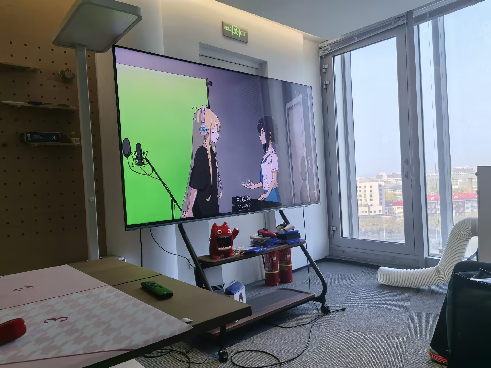
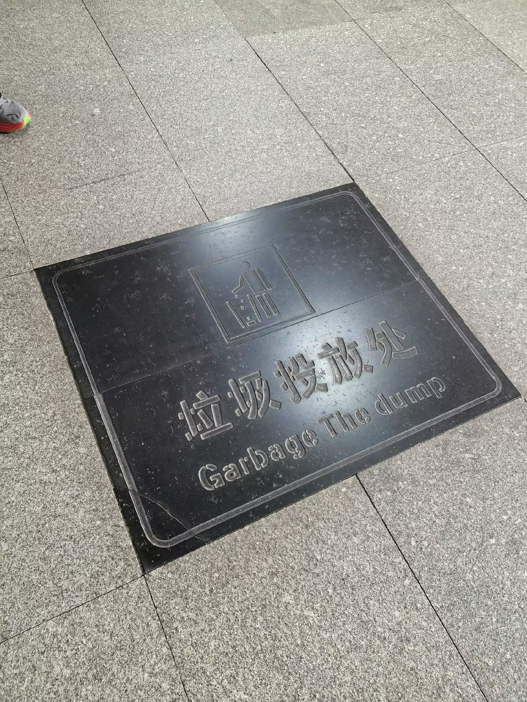
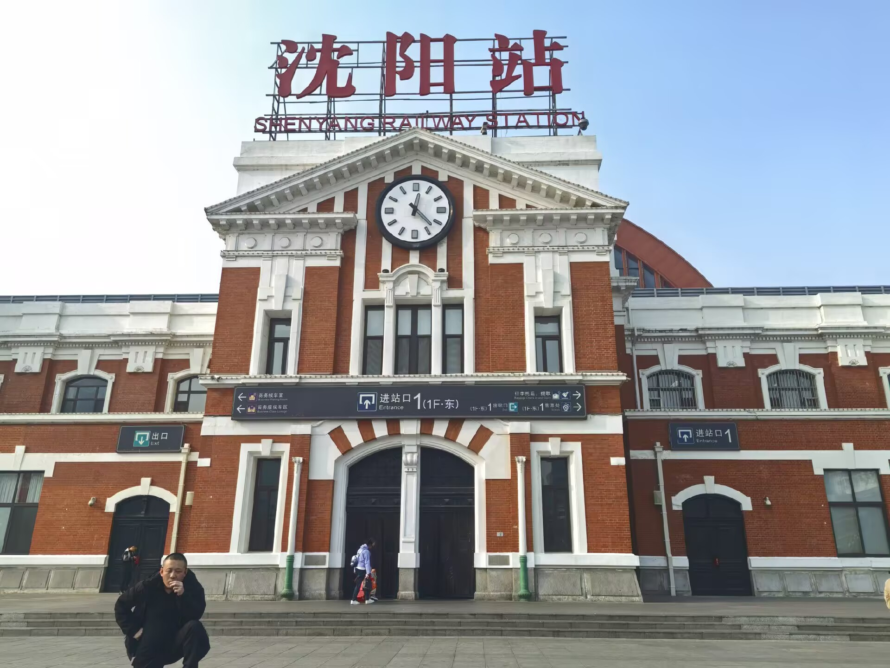
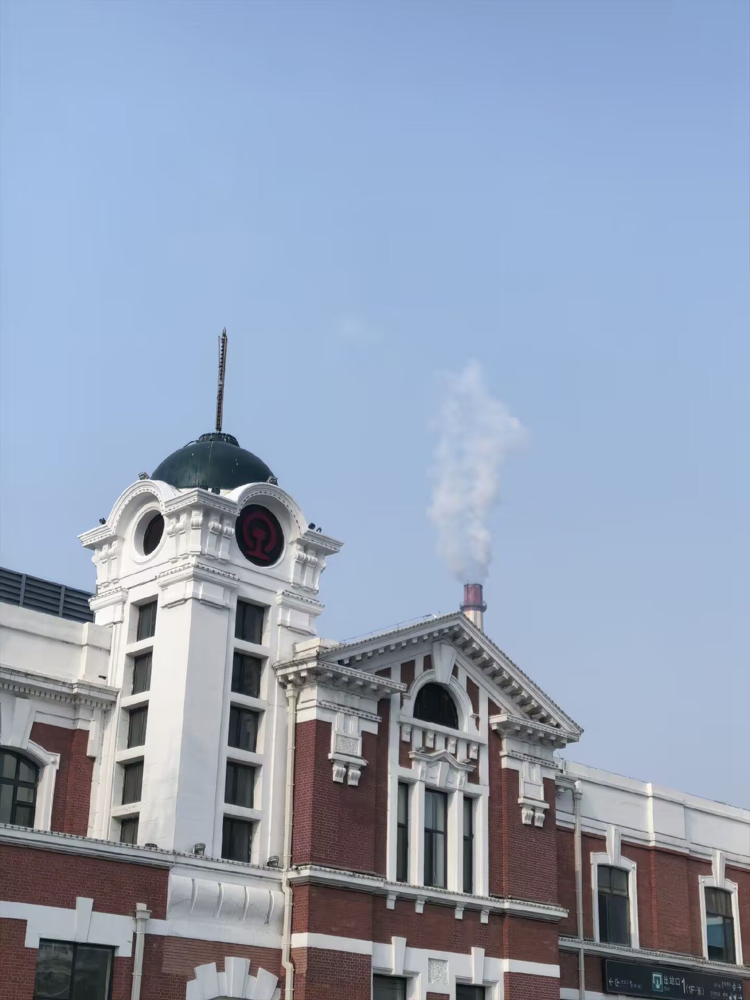
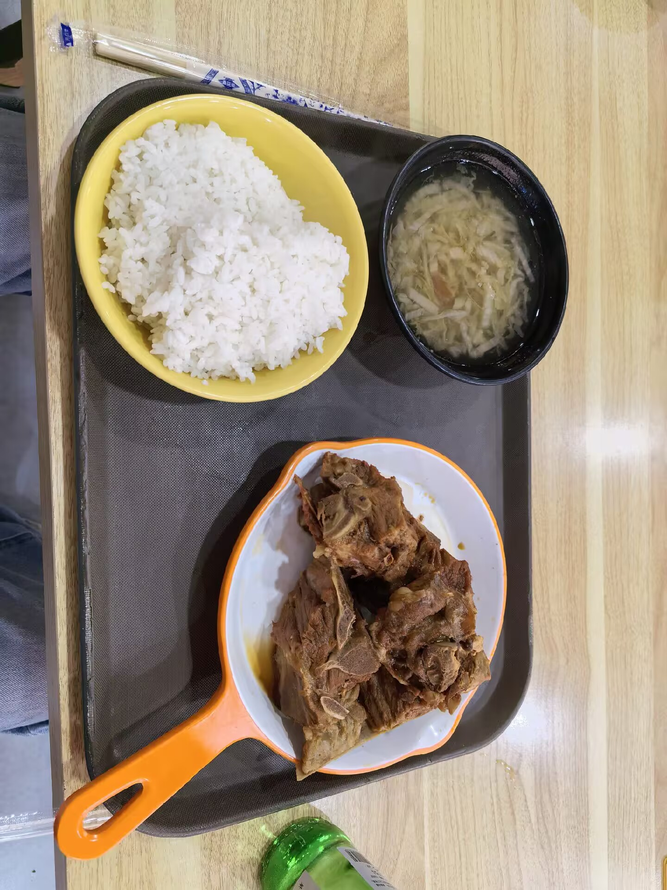
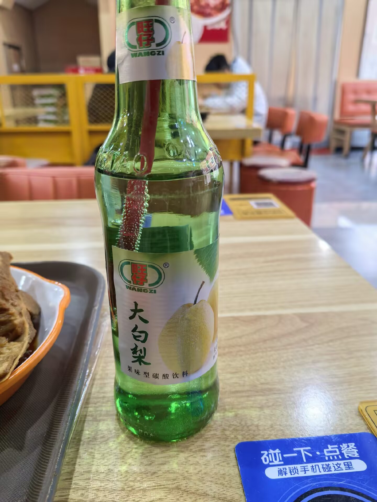

这周考完了期中考，然后也拿到了成绩。

只能说 gpt 老师考前拟合的效果还是不错的。

倒是计算概论换了新的老师，那个日本留学归来的老师。讲的课是很好，就是早八之后连续上三节课实在是太难了，很容易犯困。

周末要参加沈阳区域赛，队友们在周五就来到了北京。

把我们（前）教练女朋友从熊窝带了回来，并且和周大哥严肃观看了百合大电影。

不得不说彩叶越看越可爱、聪明，辉夜怎么看都是一种憨憨、笨笨的感觉。

训练的内容是 GP of Wuhan，虽然也没怎么打好。主要问题是我某种直觉还不够好，然后可能分工也没有搞好。

晚上去品尝了一下北京的居酒屋。感觉东西做的还算能吃，就是寿司做的不如滨寿司。

然后把教练和她的女朋友成功塞进了箱子里面

我发现教练和她的女朋友塞进箱子里面刚刚好！

然后从北京朝阳站坐高铁两个半小时到了沈阳。

沈阳是东北的一个知名城市吧，离北京比较近。我也是第一次去东北。

我们在火车进东北的时候就感觉路上空气质量在越来越差，能见度越来越低，可能是重工业影响。

下车有个不知干啥用的路标。

沈阳站，有种前苏联的那种建筑的感觉。

然后，就在站台的后面，就是一座大烟囱。

贴脸开大了属于是。

感受是东北没有什么外地人，路人都是一嘴标准的东北口音。

倒是东北人非常热情，司机给我们推荐了很多好吃的店，虽然大部分都没什么时间去试试看。

在东北的第一顿吃了酱排骨，就是那种很平常的路边小店。

倒是一点都不贵，米饭和紫菜汤也是无限续的。

这个酸菜汤非常有感觉，很开胃（？

还有根本没有见过的小甜水，挺好喝的

可能外地根本找不到。

