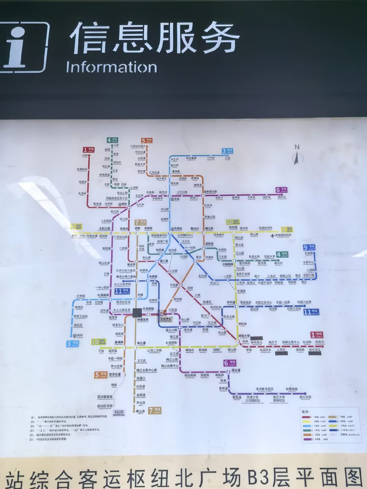
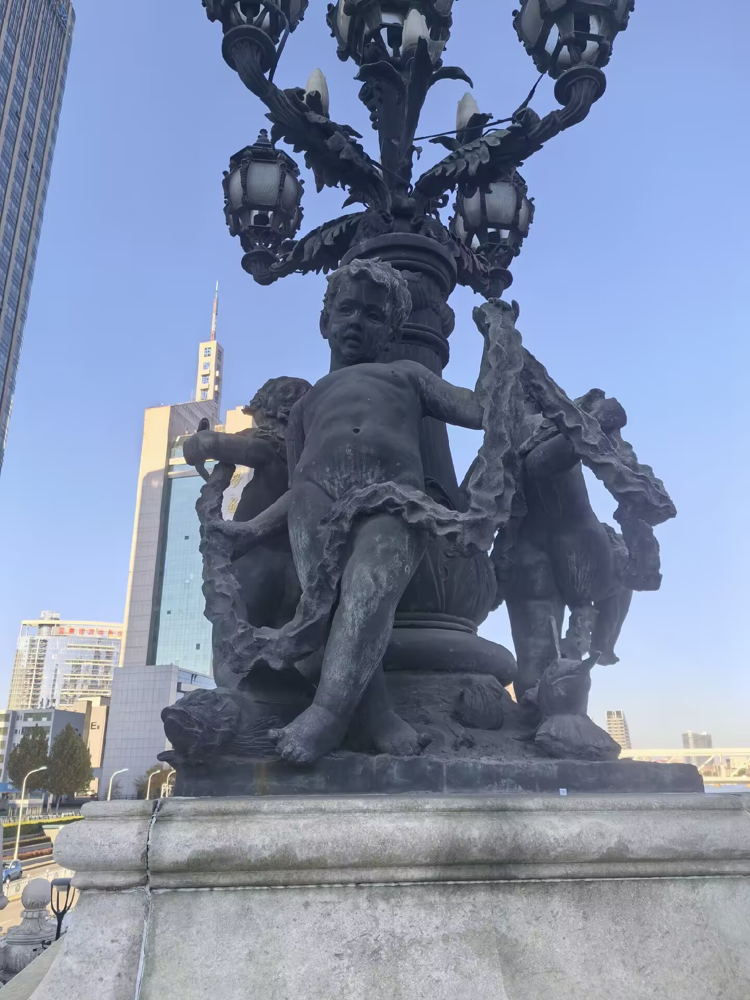
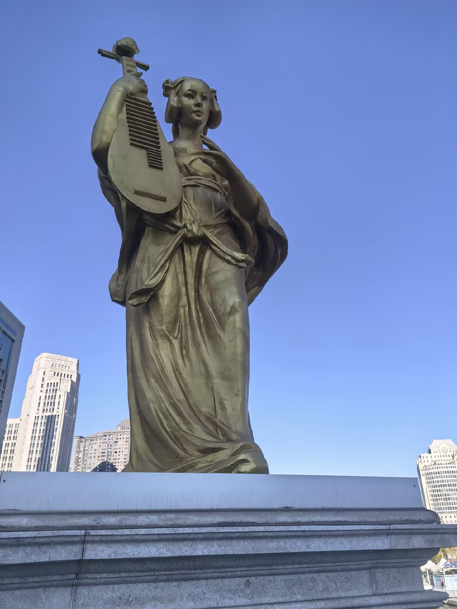
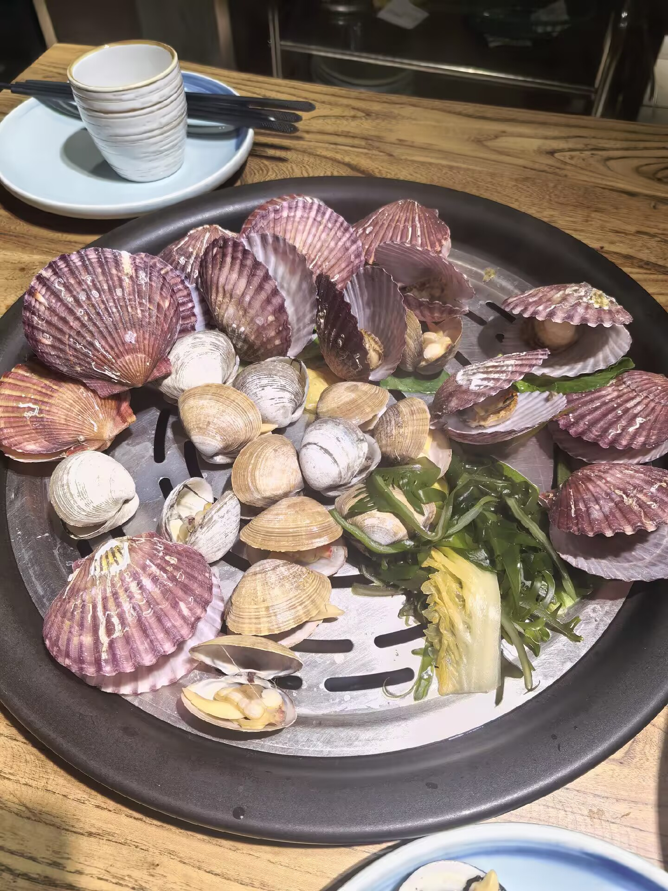
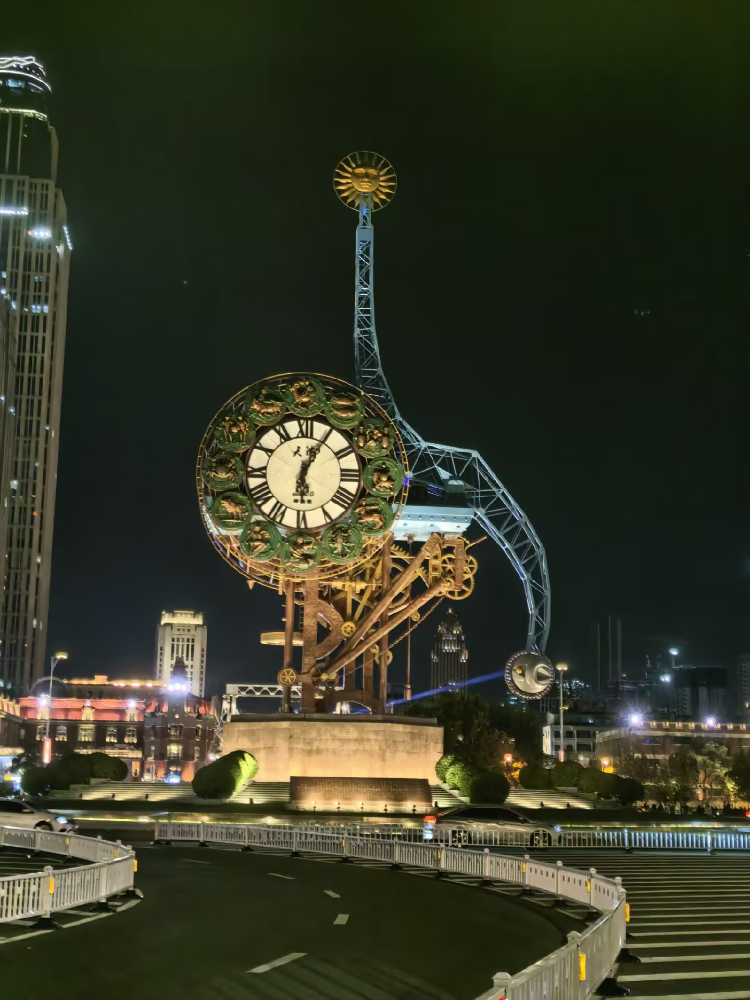
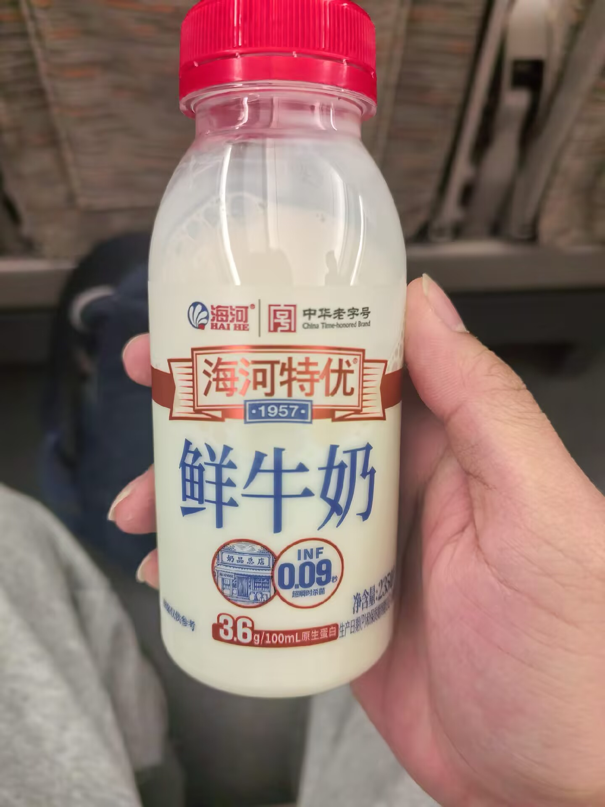
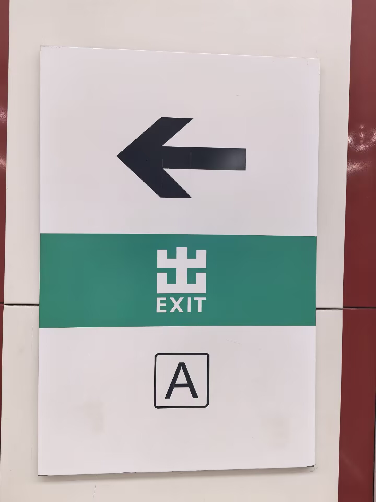
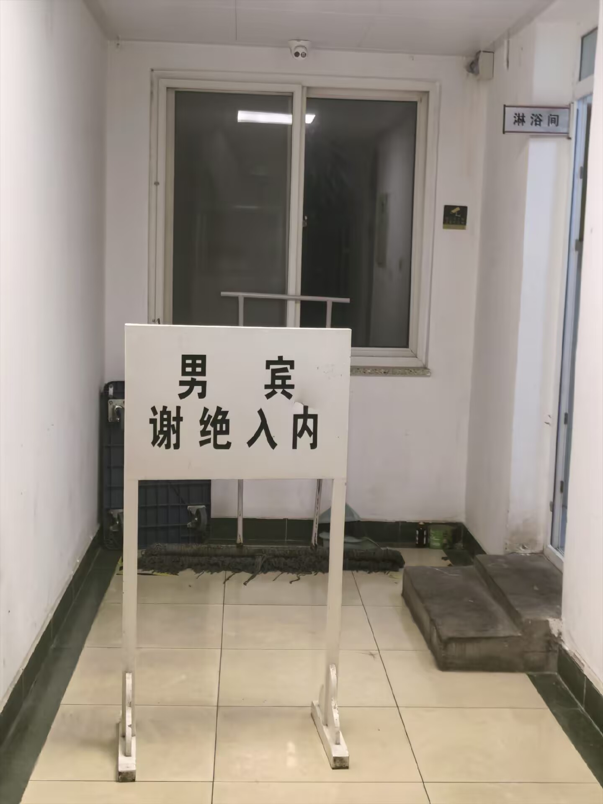
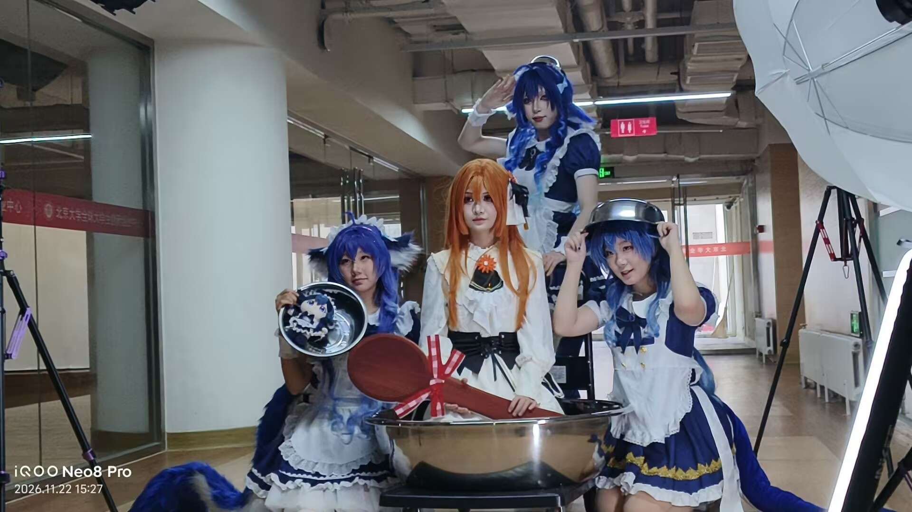
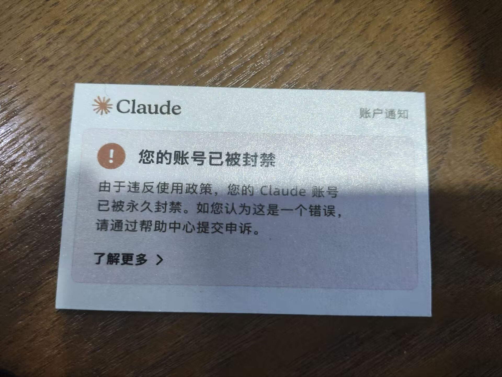

我愿把 2026 年称为 AI 元年。

信息量实在是太多了，这一年，甚至其实只有两个月的数学、计算机理论（TCS）、物理的发展已经超过了过去十年、甚至二十年、更大胆一千年的总和了。

我也是每天都被突如其来的核弹爆射，然后瘫坐眩晕在椅子上。

哎，看看这周的事情吧。

大概是通过某种方式订阅到了相对稳定的 Claude。克劳德大小姐感觉体验上是要比 gpt 牛上不少的，只可惜不能在我自己这台机器上跑，拉了一个北美破败服务器出来跑。

周末去了天津玩，躲避核弹攻击，放点图片吧。

这家海鲜吃着还不错，至少感觉应该是新鲜的，而且好吃。

富有天津特色的牛奶，宣传是不喝就白来天津卫了。实际上就是那股标准的牛奶的味道，没什么特别的。

一个比较好玩的是周日的 pku cosplay 咖啡厅。

其实就是个小号的漫展，有摄影会和一些什么交流会。

